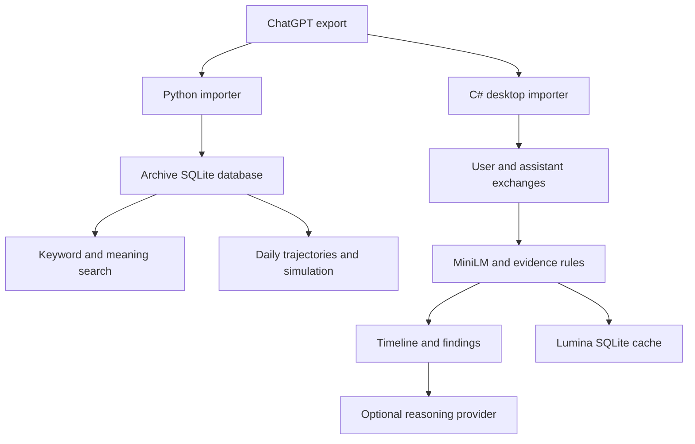

# Lumina source review — 2026-09-09

Reviewed main at `ea3d6466015c4f6ed583038b2565a3974cc7a264`, then prepared changes on `codex/lumina-search-evaluation`.

## What exists

Lumina is a Windows analysis app plus a Python archive app in one repository. It is not yet one shared analysis engine or one shared database.

| Component | What the current source does | Limits that matter |
| --- | --- | --- |
| Python Archive Explorer | Imports exports into SQLite; browses threads; keyword search; exact phrase patterns; trajectory and simulator pages | Existing importer replaces its destination database; choose a fresh trial path |
| Python semantic message index | Stores sentence vectors and finds similar messages | Main used MiniLM only; semantic message search was CLI-only |
| C# Lumina desktop | Merges exports, builds exchanges, produces evidence events and longitudinal findings, opens an embedded archive window | Windows WPF/WebView2 application; source inspection does not prove the packaged GUI runs |
| C# local embedding engine | MiniLM ONNX, 384 dimensions, BERT tokenizer, at most 256 tokens per input | Another model requires a compatible tokenizer, output contract, and cache design |
| C# timeline sampling | Selects up to 1,200 dated user exchanges of at least 40 characters | Short/undated exchanges are excluded from that sample. Existing cache contents can add coverage on later runs |
| C# event extraction | Splits user text and compares event candidates with semantic prototypes plus rules | Separate from the 1,200-exchange sample; model thresholds and rules affect which evidence survives |
| Cloud adapters | Azure OpenAI, legacy OpenAI, and Ollama clients exist | External services are optional; this review did not call them |
| Azure hosting / Azure SQL | No deployment implementation or SQL Server storage adapter found in the inspected tree | Planned direction, not a verified hosted system |

## How the parts connect

The C# app can launch the Python server in an embedded window, but that does not merge the two databases or replace its own embedding model.

## Findings and fixes in this branch

1. **Meaning search was absent from the search screen.** Added a Keywords/Meaning selector, ranked source links, role filtering before ranking, and clear missing-index/dependency errors. It does not build an index during a search request.
2. **Models could overwrite each other's message vectors.** Migrated the Python table from `message_id` as the only key to `(message_id, model_name)`. Legacy rows are preserved. A rebuild adds content hashes and refreshes legacy rows whose original text cannot be verified.
3. **Changed message text could reuse old vectors.** New builds hash text, refresh changed messages, and exclude known-stale vectors from search.
4. **Invalid vectors could appear as zero-similarity results.** Search now rejects malformed, mismatched, zero, and non-finite vectors; it calculates norms from the stored vectors.
5. **Build failures could leave part of a batch inserted.** Batch savepoints make failed batches roll back together.
6. **The Python CLI and desktop could use different databases by default.** Search and trajectory building now use the Archive Explorer resolver. Explicit `--db` and `CHAT_DB` are supported. Typos in search paths no longer create empty databases.
7. **Semantic dependencies were missing from the documented source workflow.** Added a dedicated optional requirements file and Windows setup/test scripts.
8. **The C# console app read its embedding table before initialization.** Added initialization before the first read. Added an empty-sample guard before `First()`/`Last()`.
9. **CI only checked syntax/imports.** Added the regression suite to the existing Python CI workflow.
10. **There was no scored retrieval comparison.** Added synthetic fixtures, ranking metrics, model/environment metadata, a demo database builder, and run instructions.

## Why a model swap alone was insufficient

The old Search screen was keyword-only. The C# model truncates long input. Its timeline analysis uses sampled embeddings and several rule/threshold layers. Its embedding cache stores no model identifier, so replacing the model in place is unsafe even when vector dimensions match.

The Python comparison measures retrieval. It does not validate the C# event classifications, change detectors, forecasts, or assistant-versus-user evidence handling across a real history. Success on a retrieval benchmark must not be presented as proof of accurate personal predictions.

## Remaining decisions and milestones

| Milestone | State after this change | Next concrete step |
| --- | --- | --- |
| Source-backed inventory | Complete | Keep this status alongside future changes |
| Repeatable retrieval checks | Implemented; local measured results in the benchmark report | Run the supplied Windows script |
| Search by meaning in source app | Implemented and regression-tested | Try the synthetic demo, then a separate private trial database |
| Best model for the user's archive | Not established | Evaluate representative private queries and inspect source matches |
| New model in the C# desktop | Not implemented | Add a compatible embedding adapter and model-specific cache; recalibrate detector thresholds |
| Long-message/context retrieval | Open | Compare chunk retrieval and context windows against whole-message embeddings |
| Unified desktop/archive data | Open | Define import synchronization and one explicit database selection contract |
| Full Windows suite release | Existing build workflow | Review this branch and build/test on Windows before releasing |
| Azure hosting and Azure SQL | Planned | Define storage/API boundaries after local retrieval quality is acceptable |

Private conversation exports were not available in this checkout. The historic import counts from previous sessions are not used as current measurements. No private chat records, keys, or databases are included in the branch.

## Start here

[Run Lumina and test the search](../RUN-LUMINA.md) covers fetching this branch, the model comparison, the browser demo, private archive trials, the C# desktop, the console app, and the existing Windows packaging command.

## Verification record

- All 18 Python regression checks passed locally, including legacy schema migration, preserving multiple models, edited-text invalidation, batch rollback, role filtering, malformed vectors, source-text escaping, missing indexes, invalid FTS syntax, known ranking metrics, and missing-path behavior.
- Ran actual local inference for MiniLM, BGE-M3, raw RoBERTa, and Qwen3-Embedding-4B. [Measured results](EMBEDDING-RESULTS.md) and [raw synthetic records](embedding-results.jsonl) are included.
- Generated a fresh synthetic archive, indexed all 30 messages with BGE-M3, and built 30 daily trajectory states. A real CLI meaning query returned the expected source first.
- Exercised dashboard, health, browse, phrase patterns, trajectory, simulation, conversation, and keyword routes against that archive; all returned HTTP 200. The meaning route ran actual BGE-M3 inference and returned the expected source link.
- Python compilation and Git whitespace checks passed.
- The .NET SDK was available after extraction, but the solution build could not restore packages: the execution service reported a network approval cancellation. The two C# console fixes have been inspected but not build-verified here. The Windows GUI, PowerShell scripts, and packaged suite still require a Windows run. No .NET success is implied by the Python tests.
- No Azure deployment, API request, release publication, or main-branch merge was performed by this task.
